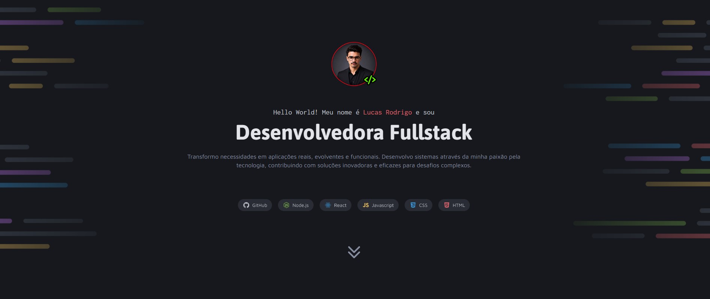

# 💻 Portfólio Dev

Portfólio pessoal desenvolvido para apresentar meus projetos, habilidades e serviços na área de desenvolvimento Full Stack.

## 🚀 Demonstração

**Acesse o projeto:** [Clique aqui](https://lucas072-cpu.github.io/portifolio-dev/)

## 🛠️ Tecnologias utilizadas

- HTML5
- CSS3
- Google Fonts

## 📂 Funcionalidades

- Apresentação pessoal e profissional.
- Galeria de projetos com links para o GitHub.
- Seção de serviços oferecidos.
- Área de contato com links para redes sociais.

## 👨‍💻 Autor

**Lucas Rodrigo**

- [GitHub](https://github.com/lucas072-cpu)
- [LinkedIn](https://www.linkedin.com/in/lucas-r-ba097a205)
